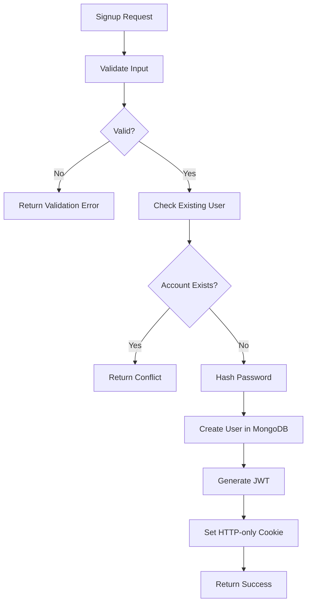
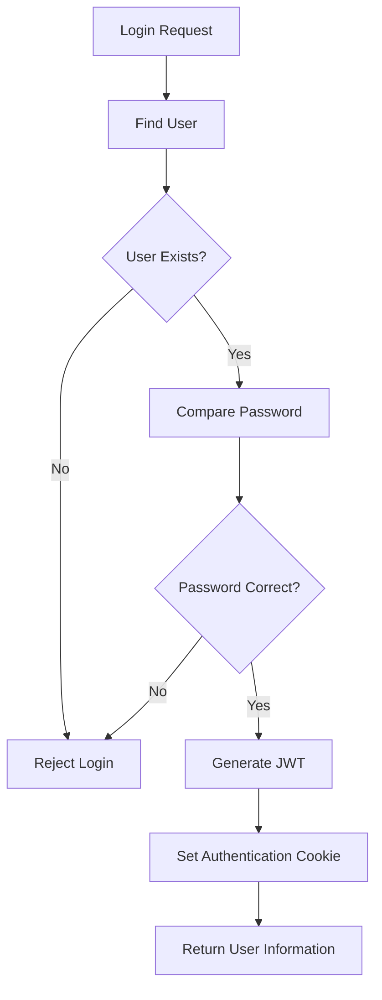
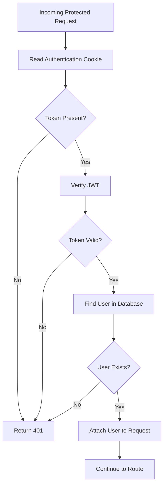
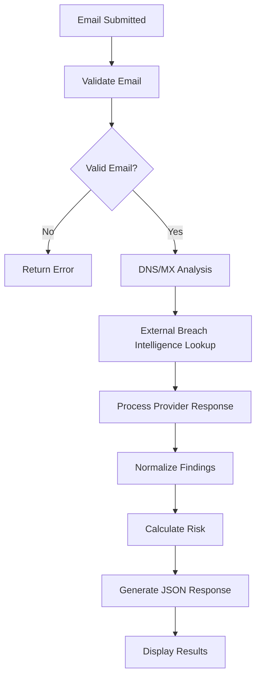
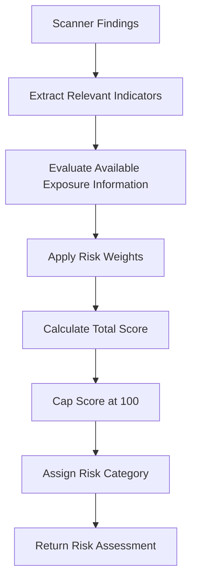
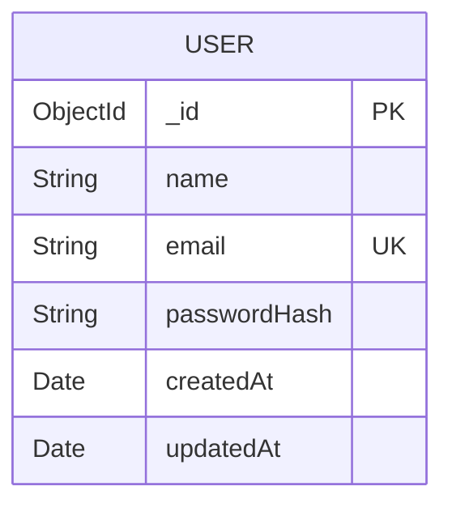
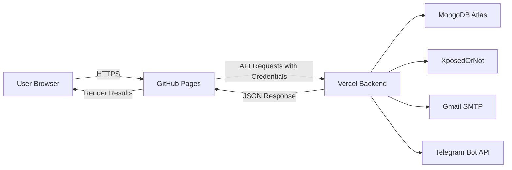

# Trace_My_Self 🔍

### Discover Your Digital Footprint. Understand Your Online Exposure. Protect Your Privacy.

<p align="center">
  <strong>A Privacy-Focused Digital Footprint & Exposure Analysis Platform</strong>
</p>

<p align="center">
  
  
  
  
  
</p>

<p align="center">
  <a href="https://satyamtiwari23.github.io/Trace_My_Self/">Live Demo</a> •
  <a href="#-features">Features</a> •
  <a href="#-system-architecture">Architecture</a> •
  <a href="#-installation-and-setup">Installation</a> •
  <a href="#-api-documentation">API</a>
</p>

---

# 📌 Table of Contents

1. [Introduction](#-introduction)
2. [Why This Project?](#-why-this-project)
3. [Project Objectives](#-project-objectives)
4. [Features](#-features)
5. [How Trace_My_Self Works](#-how-trace_my_self-works)
6. [Technology Stack](#-technology-stack)
7. [Project Structure](#-project-structure)
8. [Authentication and Verification](#-authentication-and-verification)
9. [Email Exposure Analysis](#-email-exposure-analysis)
10. [Phone Number Analysis](#-phone-number-analysis)
11. [Risk Assessment Engine](#-risk-assessment-engine)
12. [API Documentation](#-api-documentation)
13. [Database Design](#-database-design)
14. [Security Architecture](#-security-architecture)
15. [Installation and Setup](#-installation-and-setup)
16. [Environment Variables](#-environment-variables)
17. [Deployment Architecture](#-deployment-architecture)
18. [Error Handling](#-error-handling)
19. [Limitations and Important Notes](#-limitations-and-important-notes)
20. [Future Enhancements](#-future-enhancements)
21. [Use Cases](#-use-cases)
22. [Learning Outcomes](#-learning-outcomes)
23. [Contributing](#-contributing)
24. [Disclaimer](#-disclaimer)
25. [License](#-license)
26. [Acknowledgements](#-acknowledgements)

---

# 🚀 Introduction

**Trace_My_Self** is a privacy-focused digital footprint analysis platform designed to help individuals understand what information associated with their email addresses and phone numbers may be exposed across online services and publicly available breach intelligence sources.

In today's digital world, people create accounts on numerous websites, applications, and online platforms. Over time, their personal information may become part of data breaches, leaked datasets, or other publicly reported security incidents.

Most users have little visibility into where their information may have appeared or what risks that exposure could create.

Trace_My_Self aims to make this information easier to understand through a unified platform that combines:

- Email address analysis.
- Phone number validation and analysis.
- Email ownership verification.
- Phone ownership verification.
- Authentication and protected scanning.
- Breach intelligence integration.
- Risk assessment and categorization.
- Structured exposure reports.

Rather than simply displaying raw technical information, the platform aims to translate available intelligence into understandable findings that help users make better privacy and security decisions.

**Core idea:**

> Your digital identity leaves traces across the internet. Trace_My_Self helps you understand those traces.

## 🌐 Live Application

**Frontend:**

https://satyamtiwari23.github.io/Trace_My_Self/

**Backend API:**

https://trace-my-self.vercel.app

**Backend Health Check:**

https://trace-my-self.vercel.app/api/health

---

# 💡 Why This Project?

Personal information has become one of the most valuable assets in the digital world.

Every time someone registers on a website, subscribes to a service, downloads an application, or creates an online account, they share information such as:

- Email addresses.
- Phone numbers.
- Names.
- Locations.
- Account-related information.

If an online service experiences a data breach, some of this information may become exposed.

However, many users do not know:

1. Whether their email address has appeared in known breach intelligence.
2. Which breach incidents may be associated with their email.
3. What categories of information were reportedly exposed in those incidents.
4. Whether their phone number is formatted correctly for further analysis.
5. What their potential exposure means from a security perspective.
6. What steps they should take to improve their privacy.

Existing security tools often present technical information that may be difficult for non-technical users to interpret.

Trace_My_Self was created to address this usability gap.

## The Problem

| Existing problem | Trace_My_Self approach |
|---|---|
| Users lack visibility into their digital footprint | Provide a centralized analysis interface |
| Breach information can be difficult to understand | Present structured exposure findings |
| Raw results do not clearly communicate severity | Calculate a separate risk score |
| Phone and email checks are disconnected | Provide both analysis modes in one application |
| Unauthorized users could misuse scanning functionality | Require authentication and verification before protected scans |
| Security information is often technical | Present results in a more understandable format |

## Project Motivation

This project was also developed as a practical exploration of full-stack software engineering, API integration, authentication, database management, security engineering, and system architecture.

It demonstrates how individual technologies can work together to create a complete web application rather than isolated programming exercises.

---

# 🎯 Project Objectives

The primary objectives are:

1. Build a responsive and user-friendly digital footprint analysis platform.
2. Integrate external breach intelligence for email analysis.
3. Implement email and phone input validation.
4. Introduce ownership verification before sensitive scanning operations.
5. Develop a secure authentication system.
6. Protect backend endpoints using JWT-based authentication.
7. Store user account information using MongoDB.
8. Develop a custom risk assessment engine.
9. Present structured findings instead of raw API responses.
10. Deploy the frontend and backend independently.
11. Follow security practices such as input validation, rate limiting, and secure cookies.

---

# ✨ Features

## 1. User Authentication

Trace_My_Self includes a user authentication system.

Features include:

- User registration.
- User login.
- Password hashing using bcrypt.
- JWT-based authentication.
- HTTP-only authentication cookies.
- Protected API endpoints.
- Current-user session checking.
- Logout functionality.
- Forgot-password workflow using email OTP.

Passwords are stored as bcrypt hashes rather than plain text.

## 2. Email Exposure Analysis

Users can submit an email address for analysis.

The email analysis pipeline includes:

- Email format validation.
- Domain and DNS/MX record checks.
- External breach intelligence lookup.
- Exposure result processing.
- Structured findings.
- Risk score calculation.

The application uses XposedOrNot breach intelligence for its email analysis integration.

## 3. Phone Number Analysis

The application also provides a phone-number analysis mode.

The current implementation includes phone input validation and phone-related processing through the backend.

The platform also includes a phone ownership verification workflow using Telegram contact sharing.

**Important:** Phone-number validation and ownership verification are not the same as finding a phone number in leaked databases. A comprehensive public phone-number breach lookup is not currently configured.

## 4. Email OTP Verification

The application supports email verification using one-time passwords.

The verification process helps establish that the user can access the submitted email address.

## 5. Telegram-Based Phone Verification

The phone verification workflow uses a Telegram bot.

The intended flow requires users to share their own phone contact with the bot to establish phone ownership.

## 6. Risk Assessment

Trace_My_Self converts available exposure findings into a numerical risk score.

The result includes:

- Risk score.
- Risk level.
- Exposure findings.
- Supporting information.

## 7. Protected Scanning

The scanning endpoint is protected by authentication middleware.

Users must have a valid login session before accessing protected scanning functionality.

## 8. Responsive Interface

The frontend uses a dark, cyber-inspired visual design.

It provides a unified interface for entering information, initiating analysis, and viewing results.

---

# ⚙️ How Trace_My_Self Works

The overall workflow is divided into several stages.

## Step 1 — User Registration

A new user creates an account by providing:

- Name.
- Email address.
- Password.

The backend validates the submitted information and securely hashes the password before storing the user account in MongoDB.

## Step 2 — User Login

The user logs into the application.

The backend:

1. Validates the submitted credentials.
2. Retrieves the corresponding user from MongoDB.
3. Compares the submitted password against the stored bcrypt hash.
4. Generates a JWT if authentication succeeds.
5. Sends the JWT through an HTTP-only cookie.

## Step 4 — Select Scan Type

The user selects the available analysis mode:

- Email.
- Phone.

The application submits the appropriate input to the backend.

## Step 3 — Ownership Verification

Before scanning, the application uses its verification workflows.

**Email verification:**

1. User submits an email address.
2. Backend generates an OTP.
3. OTP is delivered through email.
4. User submits the OTP.
5. Backend validates the OTP.

**Phone verification:**

1. User initiates phone verification.
2. The Telegram verification workflow is started.
3. User shares their own phone contact with the Telegram bot.
4. Backend checks the verification state.

## Step 5 — Backend Processing

The backend validates the request and executes the corresponding scanning or analysis logic.

For email analysis, it checks the email format, performs DNS/MX-related checks, and queries the configured breach intelligence provider.

## Step 6 — Risk Assessment

The risk engine processes the available findings and calculates an overall risk score.

## Step 7 — Display Results

The backend returns structured JSON.

The frontend processes the response and displays the analysis results.

---

## 🛠️ Technology Stack

### Frontend

| Technology | Purpose |
|---|---|
| HTML5 | Application structure |
| CSS3 | Styling and responsive interface |
| JavaScript | Frontend logic and API communication |
| Fetch API | HTTP communication with backend |

### Backend

| Technology | Purpose |
|---|---|
| Node.js | JavaScript runtime |
| Express.js | REST API framework |
| Mongoose | MongoDB object modeling |
| bcryptjs | Password hashing |
| jsonwebtoken | JWT authentication |
| cookie-parser | Cookie handling |
| cors | Cross-origin request configuration |
| helmet | HTTP security headers |
| express-rate-limit | API rate limiting |
| validator | Input validation |
| Nodemailer | Email delivery |
| crypto | Secure OTP generation and hashing |

### External Services

| Service | Purpose |
|---|---|
| MongoDB Atlas | Cloud database |
| XposedOrNot | Email breach intelligence |
| Gmail SMTP | Email OTP delivery |
| Telegram Bot API | Phone ownership verification |
| GitHub Pages | Frontend hosting |
| Vercel | Backend hosting |

## 📁 Project Structure

The project is organized into two main directories.

```text
Trace_My_Self/
│
├── frontend/
│   ├── index.html
│   ├── script.js
│   └── style.css
│
├── backend/
│   ├── server.js
│   ├── auth.js
│   ├── emailScanner.js
│   ├── phoneScanner.js
│   ├── riskEngine.js
│   ├── verification.js
│   ├── package.json
│   ├── package-lock.json
│   ├── .env
│   └── node_modules/
│
├── .gitignore
└── README.md
```

## 🔐 Authentication and Verification

Trace_My_Self uses JWT-based sessions stored in HTTP-only cookies.

### User Model

The application uses a Mongoose user schema.

| Field | Type | Purpose |
|---|---|---|
| `_id` | ObjectId | Unique user identifier |
| `name` | String | User's name |
| `email` | String | Unique email address |
| `passwordHash` | String | Hashed password |
| `createdAt` | Date | Account creation timestamp |
| `updatedAt` | Date | Last update timestamp |

Passwords are never intentionally stored as plain text.

### Registration Flow



### Login Flow


### JWT Authentication

After successful authentication, the backend generates a JWT containing the user's identifier.

The token is signed using a private server-side secret.

The cookie configuration uses:

- `httpOnly: true`
- `secure: true` in the deployed HTTPS configuration
- `sameSite: none` for cross-site frontend/backend communication
- `path: /`
- A seven-day cookie lifetime

The frontend uses credentialed requests so the browser can send authentication cookies.

The backend verifies the JWT through the `requireAuth` middleware.

### Protected Route Flow



### Password Reset

The application includes a forgot-password workflow.

The process:

1. User submits an email address.
2. Backend checks the account.
3. If an account exists, a six-digit OTP is generated.
4. The OTP is hashed using HMAC-SHA256.
5. OTP is delivered through Gmail SMTP.
6. The user submits the OTP and new password.
7. Backend checks OTP validity and expiry.
8. The password is hashed using bcrypt.
9. The updated password is saved in MongoDB.

The OTP expires after 10 minutes, and incorrect attempts are limited.

## 📧 Email Exposure Analysis

Email analysis is one of the primary capabilities of Trace_My_Self.

### Analysis Pipeline



#### 1. Email Validation

The submitted email address is validated using the `validator` package.

Invalid email addresses are rejected before external processing.

#### 2. DNS and MX Analysis

The application performs domain-related checks, including MX record analysis.

MX records identify the mail servers responsible for receiving email for a domain.

These checks provide domain-related information but do not prove that an individual mailbox is active or belongs to the user.

#### 3. Breach Intelligence Integration

The email scanner integrates with XposedOrNot.

The provider supplies breach-related intelligence associated with the submitted email address.

The application processes the available response to extract relevant information such as:

- Number of matching breach records.
- Breach or incident information.
- Reported exposed data categories.
- Associated metadata, where available.

#### 4. Finding Normalization

External provider responses are transformed into a consistent structure.

This allows the frontend to display findings without depending directly on the provider's original response format.

#### 5. Risk Calculation

The normalized findings are passed to the risk engine.

The final response includes the risk score, risk level, findings, metadata, and provider information.

### Important Interpretation

A breach record may describe categories of information exposed in an incident.

It does not necessarily prove that every listed category was exposed for every individual account in that incident.

Trace_My_Self should therefore be understood as an exposure intelligence and awareness tool, not a guarantee of complete personal data discovery.

## 📱 Phone Number Analysis

Trace_My_Self provides a separate phone-number analysis workflow.

The phone scanner is responsible for phone-related processing, while the verification module handles the ownership verification workflow.

### Current Capabilities

- Phone input validation.
- Phone-related backend processing.
- Telegram-based contact verification.
- Integration with the broader scanning workflow.

### Current Limitation

A comprehensive public phone-number breach lookup provider is not configured in the current implementation.

Therefore, phone validation or successful ownership verification must not be interpreted as confirmation that the phone number has been searched across all leaked databases.

## 📊 Risk Assessment Engine

File: `backend/riskEngine.js`

The risk engine converts technical exposure findings into a more understandable security assessment.

Instead of forcing users to interpret raw provider responses, the application generates a numerical score and a risk classification.

### Risk Levels

| Risk level | Score range | Interpretation |
|---|---|---|
| LOW | 0–19 | Limited detected exposure indicators |
| MEDIUM | 20–49 | Some exposure indicators require attention |
| HIGH | 50–100 | Significant exposure indicators require attention |

The score is capped at 100.

### Risk Assessment Process



### Why a Custom Risk Engine?

External intelligence providers may return information that is difficult to interpret directly.

A custom risk engine provides:

- A consistent scoring format.
- A simplified risk classification.
- Separation between data collection and risk evaluation.
- Flexibility to improve the scoring model later.

**Important:** The score is a project-defined assessment, not an official security rating or a statistically validated probability of identity theft.

## 🔌 API Documentation

The backend exposes REST API endpoints under:

```text
https://trace-my-self.vercel.app/api
```

For local development:

```text
http://localhost:5050/api
```

### Health Check

Endpoint:

```text
GET /api/health
```

Checks whether the backend is running.

Example response:

```json
{
  "success": true,
  "message": "Trace_My_Self backend is running"
}
```

### Authentication APIs

| Method | Endpoint | Purpose |
|---|---|---|
| POST | `/api/auth/signup` | Register a new user |
| POST | `/api/auth/login` | Authenticate a user |
| POST | `/api/auth/logout` | Clear the authentication cookie |
| GET | `/api/auth/me` | Retrieve the currently authenticated user |
| POST | `/api/auth/forgot-password/start` | Start password reset |
| POST | `/api/auth/forgot-password/reset` | Verify reset OTP and update password |

### Verification APIs

| Method | Endpoint | Purpose |
|---|---|---|
| POST | `/api/verification/email/start` | Start email verification |
| POST | `/api/verification/email/verify` | Verify email OTP |
| POST | `/api/verification/phone/start` | Start phone verification |
| GET | `/api/verification/status` | Retrieve verification status |

### Scanning API

| Method | Endpoint | Purpose |
|---|---|---|
| POST | `/api/scan` | Start a protected analysis request |

The scan endpoint uses authentication middleware and scanning authorization checks.

### Example Scan Request

The exact accepted request fields depend on the current route implementation.

Conceptually, the request contains the identifier to analyze and the selected analysis mode.

Example structure:

```json
{
  "value": "example@email.com",
  "mode": "email"
}
```

The request must be sent with the authentication cookie.

### Example Response Structure

```json
{
  "success": true,
  "mode": "email",
  "totalExposures": 1,
  "risk": {
    "score": 50,
    "level": "HIGH",
    "findings": []
  },
  "metadata": {},
  "providers": []
}
```

This is an illustrative response structure. Actual fields and findings depend on the scanner and provider response.

## 🗄️ Database Design

Trace_My_Self uses MongoDB with Mongoose.

### User Collection

The primary persistent collection is the `user` collection.



### Database Responsibilities

MongoDB stores user account information.

Mongoose provides:

- Schema validation.
- Data modeling.
- Database queries.
- User creation.
- User lookup.
- Password hash updates.

### Verification State

Verification state is managed by the verification module.

The exact persistence mechanism depends on the implementation of that module. Temporary in-memory state should not be treated as durable database storage.

## 🛡️ Security Architecture

Trace_My_Self processes personal identifiers, so security is an important design consideration.

### 1. Password Hashing

Passwords are hashed using bcrypt with a work factor of 12.

Plain-text passwords are not stored.

### 2. JWT Authentication

JWTs are signed using a server-side secret.

Protected routes validate the token before allowing access.

### 3. HTTP-only Cookies

Authentication tokens are stored in HTTP-only cookies.

This prevents ordinary frontend JavaScript from directly reading the authentication cookie.

### 4. HTTPS and Secure Cookies

The deployed application uses HTTPS.

Authentication cookies are configured with the `Secure` attribute.

### 5. Cross-Origin Resource Sharing

The Express backend uses CORS with an explicit list of allowed origins.

Credentials are enabled for authenticated browser requests.

The GitHub Pages origin is:

```text
https://satyamtiwari23.github.io
```

The repository path `/Trace_My_Self/` is not part of the origin.

### 6. Rate Limiting

The backend uses `express-rate-limit` to restrict repeated requests.

Rate limiting is configured for:

- Authentication routes.
- Scanning requests.
- Verification requests.
- OTP verification requests.

This helps reduce automated abuse and excessive requests.

### 7. Security Headers

Helmet is used to configure HTTP security headers.

### 8. Input Validation

The application validates user-provided information before processing it.

Examples include:

- Email validation.
- Name length checks.
- Password length checks.
- OTP format validation.
- Phone input processing.

### 9. OTP Security

The application uses cryptographically secure random number generation for OTP creation.

OTP values are hashed before being stored in the password-reset workflow.

OTP expiration and attempt limits are implemented.

### 10. Environment Variable Protection

Sensitive credentials are stored in environment variables instead of being hardcoded into source files.

These include:

- Database credentials.
- JWT secret.
- SMTP credentials.
- Telegram bot credentials.

### Security Considerations

Cross-site authentication depends on browser cookie policies. The application uses `SameSite=None` and `Secure` for its cross-site deployment configuration, but browser third-party cookie restrictions may still affect authentication.

A future same-site custom-domain architecture could improve compatibility.

## 💻 Installation and Setup

Follow these instructions to run Trace_My_Self locally.

### Prerequisites

Install the following:

- Node.js.
- npm.
- Git.
- MongoDB Atlas account or a local MongoDB instance.
- A code editor such as Visual Studio Code.

Additional external service configuration is required for email and Telegram verification.

### 1. Clone the Repository

```bash
git clone YOUR_REPOSITORY_URL
```

Replace `YOUR_REPOSITORY_URL` with the actual Git repository URL.

### 2. Open the Project

```bash
cd Trace_My_Self
```

Open the project in VS Code:

```bash
code .
```

### 3. Install Backend Dependencies

Open Terminal in the `Trace_My_Self/backend/` directory.

Run:

```bash
npm install
```

### 4. Configure Environment Variables

Create a `.env` file inside:

```text
Trace_My_Self/backend/
```

Add the required configuration values.

See the environment variable section below.

### 5. Start the Backend

From the `Trace_My_Self/backend/` directory, run:

```bash
node server.js
```

The backend should connect to MongoDB and start listening on the configured port.

The default local port is:

```text
5050
```

### 6. Run the Frontend

Open the `Trace_My_Self/frontend/` directory in VS Code.

Use the Live Server extension or another static HTTP server.

For example, with VS Code Live Server, open `index.html` and select **Open with Live Server**.

The local frontend URL may look like:

```text
http://127.0.0.1:5501
```

Ensure the backend CORS configuration allows the local frontend origin.

### 7. Verify Backend Connectivity

Open:

```text
http://localhost:5050/api/health
```

Expected response:

```json
{
  "success": true,
  "message": "Trace_My_Self backend is running"
}
```

If this response appears, the local backend health endpoint is responding successfully.

## 🔑 Environment Variables

Create the following file:

```text
backend/.env
```

Example configuration:

```env
# Application
PORT=5050
NODE_ENV=development

# Database
MONGODB_URI=your_mongodb_connection_string

# Authentication
JWT_SECRET=your_long_random_secret

# Gmail SMTP
SMTP_USER=your_gmail_address
SMTP_APP_PASSWORD=your_gmail_app_password

# Telegram
TELEGRAM_BOT_TOKEN=your_telegram_bot_token
```

Important:

The exact environment variables required by the verification and scanner modules must match their current source code. Check those modules before deployment.

Never publish real credentials in this README or commit the `.env` file.

### Generating a JWT Secret

You can generate a random secret using Node.js.

Run from any terminal directory:

```bash
node -e "console.log(require('crypto').randomBytes(64).toString('hex'))"
```

Copy the generated value into `JWT_SECRET`.

### Gmail SMTP Configuration

For Gmail SMTP, use an App Password where supported and configured for your Google account.

Do not use your normal Gmail account password as the SMTP password.

## ☁️ Deployment Architecture

The deployed application uses two separate hosting platforms.

### Frontend — GitHub Pages

Live URL:

```text
https://satyamtiwari23.github.io/Trace_My_Self/
```

GitHub Pages hosts the static frontend files:

- HTML.
- CSS.
- JavaScript.

The frontend communicates with the backend using HTTPS API requests.

### Backend — Vercel

Backend URL:

```text
https://trace-my-self.vercel.app
```

Vercel hosts the Node.js backend application.

The backend handles:

- Authentication.
- Database operations.
- Verification.
- Scanning.
- Risk assessment.
- External service integrations.

### Database — MongoDB Atlas

MongoDB Atlas provides cloud database hosting.

The backend connects to MongoDB using the `MONGODB_URI` environment variable.

### Deployment Diagram



### Important Deployment Configuration

When deploying the backend:

1. Configure the correct project root and deployment entry point in Vercel.
2. Configure all required environment variables in Vercel.
3. Ensure the MongoDB Atlas network configuration permits the backend connection.
4. Configure the GitHub Pages origin in the backend CORS allowlist.
5. Ensure the frontend API base URL points to the deployed Vercel backend.
6. Test the health endpoint.
7. Test registration and login.
8. Verify that the browser stores and sends the authentication cookie.
9. Test protected scanning requests.

## 🧯 Error Handling

The backend uses HTTP status codes and JSON responses to communicate errors.

| Status code | Meaning |
|---|---|
| 200 | Request completed successfully |
| 201 | Resource created successfully |
| 400 | Invalid request or input |
| 401 | Authentication required or invalid session |
| 403 | Request not authorized |
| 404 | Resource or route not found |
| 409 | Duplicate account or conflicting data |
| 429 | Rate limit exceeded |
| 500 | Internal server error |

The frontend should handle unsuccessful responses and display understandable messages.

### Common Deployment Issues

**401 Unauthorized**

Possible causes:

- User is not logged in.
- Authentication cookie is missing.
- JWT is invalid or expired.
- Browser blocks cross-site cookies.

**CORS Error**

Check:

- The frontend origin.
- Backend CORS configuration.
- Credential settings.
- Request configuration.

**MongoDB Connection Error**

Check:

- `MONGODB_URI`.
- MongoDB Atlas network access.
- Database credentials.
- Database availability.

**Email Verification Failure**

Check:

- SMTP configuration.
- Gmail App Password.
- Email delivery errors.
- Verification service configuration.

**Telegram Verification Failure**

Check:

- Telegram bot token.
- Bot availability.
- Bot configuration.
- Phone contact-sharing workflow.

## ⚠️ Limitations and Important Notes

Trace_My_Self is an evolving project. Its results should be interpreted within the capabilities of its configured data sources.

### 1. No Complete Internet-Wide Search

The platform does not scan every website, database, or private information source on the internet.

It relies on configured services and available intelligence.

### 2. Breach Intelligence Coverage

A result with no matching exposure does not guarantee that an email address has never been compromised.

Some breaches may be unknown, unavailable, unindexed, or absent from the configured provider.

### 3. Phone Exposure Lookup

Phone-number validation and ownership verification are available as separate capabilities.

A comprehensive public phone-number breach lookup is not currently configured.

### 4. Risk Score Interpretation

The risk score is generated by a custom application-defined model.

It should not be treated as a definitive measurement of the probability of identity theft or account compromise.

### 5. Third-Party Service Dependency

Email analysis and verification depend on external services.

Their availability, response formats, rate limits, and coverage may change.

### 6. Browser Cookie Restrictions

The frontend and backend currently use different domains.

Some browser privacy settings may block third-party cookies, potentially affecting login sessions.

### 7. Verification State and Serverless Deployment

Temporary in-memory state is not guaranteed to persist across serverless instances or deployments.

For production reliability, verification sessions should use a shared persistent store with expiration and atomic updates.

## 🚧 Future Enhancements

The following are potential improvements and should not be considered implemented features.

### Phase 1 — Improve Existing Functionality

- Improve scan result presentation.
- Add more detailed exposure explanations.
- Improve verification error handling.
- Strengthen session management.
- Improve deployment reliability.
- Add automated backend tests.

### Phase 2 — Advanced Digital Footprint Analysis

- Integrate additional legitimate breach intelligence providers.
- Improve phone-number intelligence integrations.
- Add username-based exposure checks.
- Add domain-related intelligence.
- Improve exposure categorization.

### Phase 3 — User Dashboard

- Historical scan records.
- Previous exposure comparisons.
- Saved reports.
- User security recommendations.
- Account activity information.

### Phase 4 — Advanced Security Features

- Automated rechecking of previously identified exposure sources.
- Monitoring for newly reported breach intelligence.
- More advanced risk assessment.
- Improved anomaly detection.
- Additional account protection mechanisms.

### Phase 5 — AI-Assisted Security Insights

- Natural-language explanation of findings.
- Context-aware privacy recommendations.
- AI-assisted exposure summaries.
- Personalized security improvement guidance.

AI-generated explanations should remain grounded in actual scan results and should not invent exposure information.

## 🎯 Use Cases

Trace_My_Self can be useful in several scenarios.

### Individual Users

People who want to understand whether their email addresses appear in known breach intelligence.

### Privacy Awareness

Users who want to become more aware of their digital footprint.

### Cybersecurity Learning

Students can explore how breach intelligence, authentication, external APIs, and risk assessment systems work together.

### Security Education

The application can demonstrate why password reuse, weak authentication, and unnecessary personal-data sharing create privacy risks.

### Developers

The project provides a practical example of a full-stack application integrating external services and security-related workflows.

## 📚 Learning Outcomes

Building Trace_My_Self involves several important software engineering concepts.

### Frontend Development

- HTML structure.
- CSS layout and responsive design.
- JavaScript DOM manipulation.
- Event handling.
- Fetch API.
- Asynchronous programming.
- API integration.

### Backend Development

- Node.js.
- Express.js.
- REST API design.
- Middleware.
- Error handling.
- Request validation.
- Rate limiting.

### Database Management

- MongoDB.
- Mongoose.
- Schema design.
- Database queries.
- User account management.

### Authentication and Security

- Password hashing.
- JWT authentication.
- HTTP-only cookies.
- CORS.
- OTP verification.
- Secure environment configuration.
- Protected routes.

### External Integrations

- REST API integration.
- DNS/MX lookups.
- SMTP email delivery.
- Telegram Bot API.
- Third-party service handling.

### Deployment and DevOps

- Git and GitHub.
- GitHub Pages.
- Vercel.
- Environment variable management.
- Production debugging.
- Cross-origin communication.

## 🤝 Contributing

Contributions, suggestions, and improvements are welcome.

To contribute:

1. Fork the repository.
2. Create a new feature branch.
3. Make your changes.
4. Test your changes locally.
5. Commit your work.
6. Open a pull request.

Example:

```bash
git checkout -b feature/your-feature-name
git add .
git commit -m "Add your feature description"
git push origin feature/your-feature-name
```

Please avoid committing:

- `.env` files.
- API credentials.
- JWT secrets.
- SMTP passwords.
- Private user information.
- Temporary verification data.

## ⚖️ Disclaimer

Trace_My_Self is developed for educational, privacy-awareness, and authorized personal security analysis purposes.

Users should only submit identifiers that they own or are explicitly authorized to analyze.

The platform uses third-party breach intelligence and external services. It does not guarantee that all data exposures will be discovered.

A successful scan does not guarantee that an account is secure, and a low-risk result does not mean that an identifier has never been exposed.

The project does not encourage unauthorized access, account compromise, identity theft, or misuse of personal information.

Users are responsible for ensuring that their use of the application complies with applicable laws, service terms, and privacy requirements.

## 📄 License

No open-source license has been specified yet.

Until a license is added to the repository, the project should not be assumed to be available for unrestricted reuse, modification, or redistribution.

## 🙌 Acknowledgements

Trace_My_Self is built using open-source technologies and external services.

Special thanks to the developers and communities behind:

- Node.js
- Express.js
- MongoDB
- Mongoose
- XposedOrNot
- GitHub
- Vercel
- Telegram
- The open-source JavaScript ecosystem
